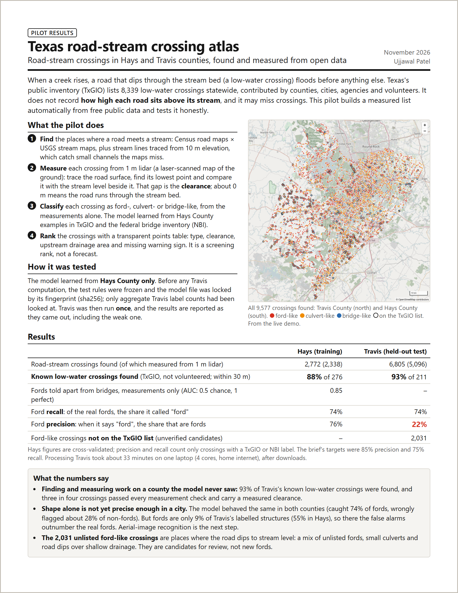
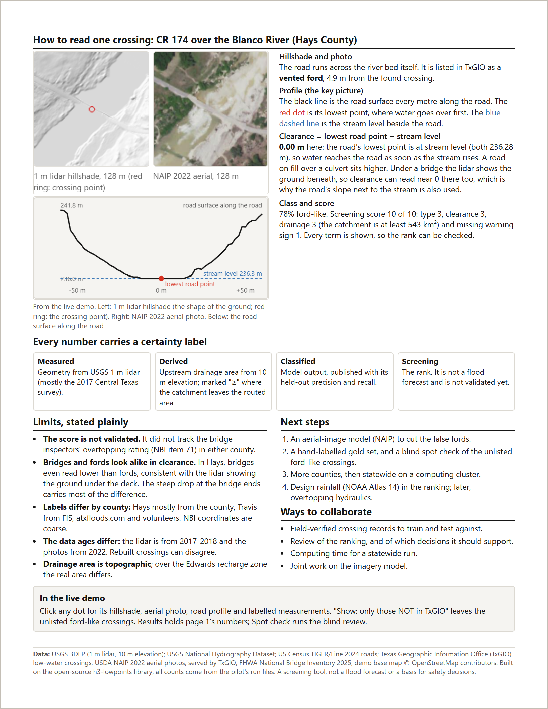

# Texas road-stream crossings: pilot demo

**[Open the live demo](https://ujjawal-01.github.io/tx-crossings-demo/)** ·
**[Two-page brief (PDF)](brief/TX_Crossings_Pilot_Brief.pdf)**

This pilot finds road-stream crossings in Hays and Travis counties (Texas), measures them from USGS 1 m
lidar, and classifies them as ford-, culvert- or bridge-like. The model was trained on Hays County and
tested once on Travis County, with the test rules fixed in advance.

## Two-page brief

## Status

Pilot results. This is a screening tool, not a flood forecast, and not for safety decisions.
The "ford-like" crossings that no inventory lists are unverified candidates. The screening score is not
validated. This repository holds only the built demo; the source code is not published.

**Data:** USGS 3DEP (1 m lidar, 10 m elevation); USGS National Hydrography Dataset; US Census TIGER/Line
2024; Texas Geographic Information Office (TxGIO) low-water crossings; USDA NAIP 2022 imagery, served live
by TxGIO; FHWA National Bridge Inventory 2025; base map © OpenStreetMap contributors. MapLibre GL JS
(BSD-3-Clause). Built on the open-source h3-lowpoints library.
